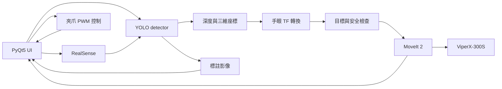

# 通用物件夾取系統設計與開發進度

## 系統目標

使用單一 UI 完成模型選擇、相機監看、目標辨識、三維座標確認、MoveIt 規劃與實體夾取，逐步減少日常操作需要手動管理的終端機。既有 `apple_pick/` 保留為獨立的蘋果流程；新功能在 `general_object_pick/` 開發與實機驗證。

## 目前架構



RViz 目前保留為獨立視窗，用於互動標記、TF 除錯及路徑預覽。UI 顯示相機辨識結果、系統狀態與操作流程。

## 已完成

### 第一階段：UI 與視覺

- [x] PyQt5 英文介面與事件紀錄。
- [x] 掃描 `models/` 並選擇 YOLO 權重。
- [x] 輸入及檢查模型支援的目標類別。
- [x] 啟動或沿用 RealSense 節點。
- [x] 顯示標註影像、類別、信心分數、數量與 FPS。
- [x] 使用對齊深度及相機內參計算三維座標。

### 第二階段：ROS、TF 與 MoveIt

- [x] 顯示 Camera、Detector、TF、MoveIt 與 Gripper 狀態。
- [x] 將相機座標轉換成 `vx300s/base_link`。
- [x] 連接外部已啟動的 MoveIt 與控制器。
- [x] 儲存目前六軸角度為命名觀察姿勢。
- [x] 觀察姿勢只規劃、RViz 預覽、二次確認後執行。
- [x] 規劃後手臂或目標移動時使舊規劃失效。

### 第三階段：蘋果實體夾取

- [x] 沿用既有蘋果夾取姿態與工作範圍。
- [x] 累積多筆座標並檢查目標穩定度。
- [x] 預覽預備、前進、退回及返回起點四段路徑。
- [x] 執行前顯示實體動作確認視窗。
- [x] 每段實體動作前依最新關節狀態重新規劃。
- [x] 張開夾爪、前進 3 公分、閉合、退回並返回原始姿勢。
- [x] 到預備點及夾取點後各停留 2.5 秒。
- [x] 修正 MoveIt `CONTROL_FAILED (-4)` 起點落差問題。

### 第四階段：夾爪控制

- [x] 提供手動 `Open Gripper` 與 `Close Gripper`。
- [x] 停用衝突的位置控制器後，由 UI 獨占 PWM 控制。
- [x] 使用已驗證的 `+350` 張開與 `-500` 閉合參數，兩者持續 `1.0 s`。
- [x] 依這台實機的 `left_finger` 回報方向驗證開關動作。
- [x] PWM 無合理位移時顯示警告；自動夾取仍會安全退回並返回起點。

## 下一步

### 1. 建立瓶子夾取設定

這是下一個建議實作項目，先用一般、不易損壞的瓶子測試通用化流程。

- [ ] 建立獨立的物品設定檔格式。
- [ ] 設定瓶子的預備高度、接近距離、末端方向與 PWM。
- [ ] 在 UI 顯示設定值，但預設只允許規劃與預覽。
- [ ] 依 RViz 路徑進行低速空跑。
- [ ] 完成實物夾取與返回測試後才標記為可執行。

每個物品設定至少需要包含：

```text
class name
enabled for execution
pregrasp offset
approach direction and distance
end-effector orientation
velocity and acceleration
open/close PWM and duration
place profile
```

### 2. 夾取結果與力道判斷

- [ ] 讀取 `/vx300s/joint_states` 的 `effort` 或可用的馬達電流資訊。
- [ ] 記錄空爪開關、夾住蘋果及夾住瓶子的基準數據。
- [ ] 結合位置停止、馬達電流與時間判斷是否可能夾到物品。
- [ ] 在 UI 顯示「夾住、空爪閉合、可能卡住、無法判斷」。
- [ ] 讓夾爪 PWM 與持續時間由物品設定檔載入，並限制安全範圍。

目前 `left_finger` 只能提供馬達位置回報，不能單獨確認物品是否在夾爪內。

### 3. 放置姿勢

- [ ] 提供 `Save Place Pose`。
- [ ] 提供 `Plan Place` 與 RViz 預覽。
- [ ] 經二次確認後執行放置並張開夾爪。
- [ ] 支援多組可命名的放置姿勢。
- [ ] 保留既有左側放置點為 `apple_left_legacy`。
- [ ] 支援放置接近高度、釋放高度、方向與速度。

放置姿勢可以由 RViz 示教後儲存；之後再加入基座座標 X、Y、Z 與 roll、pitch、yaw 輸入。每次執行前都必須通過工作範圍、IK、碰撞與路徑檢查。

### 4. 多物品與指定 ID

- [ ] 加入 ByteTrack、BoT-SORT 或同類追蹤器。
- [ ] 讓相同物品跨影格維持固定 ID。
- [ ] 在 UI 列出 ID、類別、信心分數、基座座標與穩定度。
- [ ] 允許使用者點選或輸入 ID 後鎖定目標。
- [ ] 目標消失、遮擋過久或位置偏移時使規劃失效。
- [ ] 完成一次夾取後重新掃描，避免沿用過期座標。

單一影格的偵測順序不能直接當作 ID，因為順序會隨信心分數改變。

### 5. 細長醫療器具

- [ ] 蒐集並訓練醫療器具辨識模型。
- [ ] 估計物品輪廓、長軸方向與可夾區域。
- [ ] 加入重心偏移及桌面碰撞考量。
- [ ] 為每種器具建立不同的夾爪輸出與姿態設定。
- [ ] 用替代測試物完成流程後，再測試真正器具。

鑷子等細長物品不能直接使用方框中心；辨識位置、可夾位置與物品重心可能不同。

### 6. 啟動流程與介面整合

- [ ] 加入單一 launch 或流程管理入口。
- [ ] 從 UI 啟動及停止 MoveIt、RViz 與手眼 TF。
- [ ] 顯示目前六軸角度與末端姿態。
- [ ] 改善 UI 規劃模型與 RViz 互動標記重疊問題。
- [ ] 顯示更完整的控制器與實體急停狀態。

### 7. 分割後端

- [ ] 定義 YOLO 與分割模型共用的輸出格式。
- [ ] 評估 SAM 3 的硬體需求與延遲。
- [ ] 將 SAM 3 放在獨立服務或容器，避免改動 ROS 2 Humble 主環境。
- [ ] 將遮罩、物品方向與可夾區域送入夾取策略。

SAM 3 適合文字提示與輪廓分割，但不會自動解決夾取姿態、重心、碰撞或夾爪力道問題。

## 建議開發順序

1. 瓶子物品設定與低速夾取。
2. 馬達電流紀錄與夾取結果判斷。
3. 可命名的放置姿勢。
4. 多物品固定 ID 與目標選擇。
5. 細長醫療器具的姿態與夾取策略。
6. 單一啟動入口。
7. SAM 3 或其他分割後端。

每個新物品先完成「辨識與座標 → 規劃預覽 → 空跑 → 低速實物測試 → 正式啟用」，沒有完成實機校正的類別只能辨識與預覽。
